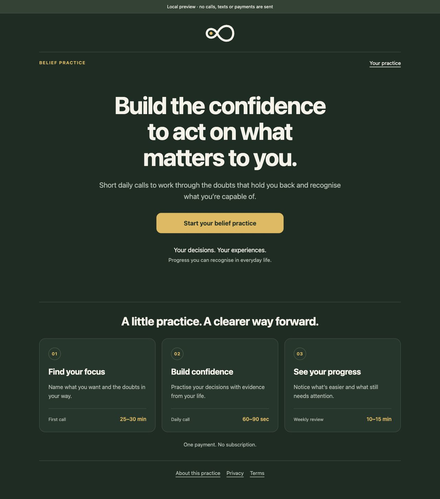
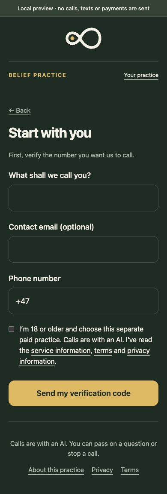

# Initial implementation verification — 11 October 2026

For the fresh 13 October continuation results and current limitations, see [continuation-verification.md](continuation-verification.md). Counts below remain historical.

The table below records the initial local implementation before deployment and provider testing. It is a historical snapshot, not the current launch status. Subsequent provisioning and conversation work are recorded below. Live purchases and calls are disabled by default.

| Check | Result |
| --- | --- |
| Complete suite with a disposable PostgreSQL cluster | **635 passed, 0 failed, 0 skipped** |
| TypeScript | Passed |
| ESLint | Passed |
| Patch whitespace | Passed |
| Local preview API journey | Verified signup, verification, scheduling, simulated purchase, outcome/backlog, two caller-authored decisions, understanding, daily reflection, two weekly periods, retirement, preparation, pause/resume and CSRF rejection |
| Voice onboarding reconciliation | Verified discovered belief IDs survive signed transcript confirmation; aggregate and daily/weekly start save atomically; selection follows the caller-confirmed order |
| Private memory | Verified caller transcript matching, idempotent saves, altered retry rejection, closed-session minimisation and base-memory isolation |
| Scheduling | Verified concurrent claim exclusion, missed-slot handling, STOP/hold/payment/pause, Oslo DST and human coverage windows |
| Account privacy | Verified scoped credential expiry, product-specific OTP, optional email, complete private export, exclusion from older weekly exports and cascading erasure |
| Billing | Fake provider responses verify one-time price equality, renewal/refund rejection, purchase isolation and duplicate confirmation notices |
| Browser | Walked signup through onboarding/account; checked final desktop landing and 390-pixel phone layout/signup, with no horizontal overflow |
| Readiness diagnostic | Correctly reports live calls OFF and missing gate names, without printing values |
| Speechify API sync | 14 fake-provider checks cover source packs, preserved voices/greetings/tools/defaults, variable-before-prompt ordering, preflight limits, private backups, saved-ID recovery, no replay of uncertain creates, exact restore of owned settings and redacted errors; offline five-agent plan checked |
| Main checkout | Unmodified; implementation lives in a separate clone/branch |

Preview: `http://127.0.0.1:8770/beliefs`. Code `000000` and payment/weekly controls are explicitly local simulations. Restarting clears preview data; the application never places a call or sends a message from this server.

Screenshots of the final design:

The suite uses synthetic data and fake provider responses. It does not establish actual phone pacing, silence preservation, AMD, provider-console tool substitution, payment/refund delivery, staffed human response or effectiveness. Speechify settings sync has not accessed a real account; capture-tool creation/attachment remains unimplemented because its detailed beta API shape could not be verified. See [Speechify API sync](../speechify-api-sync.md) for the exact boundary and server workflow. The release sequence and required real-system checks are in [launch.md](launch.md). The scripts are original reviewed drafts; research boundaries are recorded in [research.md](research.md).

Two additive migrations were included and exercised in the disposable database. The initial implementation recorded above did not change a production database, provider settings, `.env` file, call, message or charge.

## Subsequent provider and conversation verification

On 11 October 2026, the agent-creation repair was merged and deployed. The three Beliefs agents were created and their stored prompts, variables, private status, memory/recording settings, complete AMD routing and signed completion callbacks were read back. See [Speechify API sync](../speechify-api-sync.md) for that scoped account verification; capture-tool integration and live launch readiness remain incomplete.

One explicitly requested, isolated owner rehearsal connected and completed in about seven minutes. It did not enroll the owner or schedule daily calls. Its untimed transcript informed the conversation revision; private content and identifiers are excluded from this repository. That rehearsal used the preceding script and does not validate the revised prompts.

The conversation revision has 37 passing focused checks (19 settings-sync checks and 18 Beliefs checks), including managed fixed greetings, repeat-sync behaviour, greeting restore, compatibility with older restore points, and a brief caller confirmation across literal turns. TypeScript, ESLint and whitespace checks are run with this change. These are software checks, not proof of rapport, silence or provider dialogue quality. [Call experience](call-experience.md) records the new scripts' sequence and the synthetic rehearsal cases still to run with the provider.
